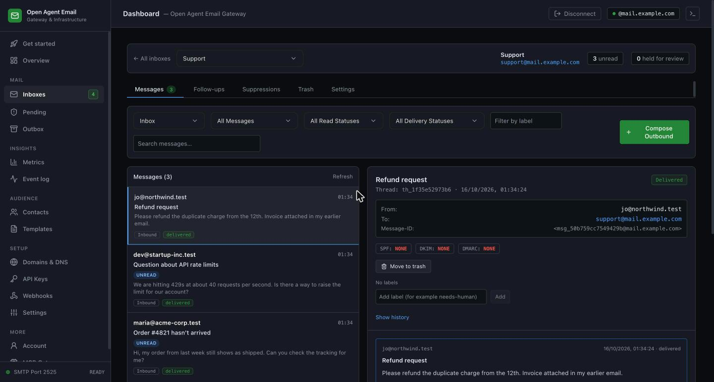
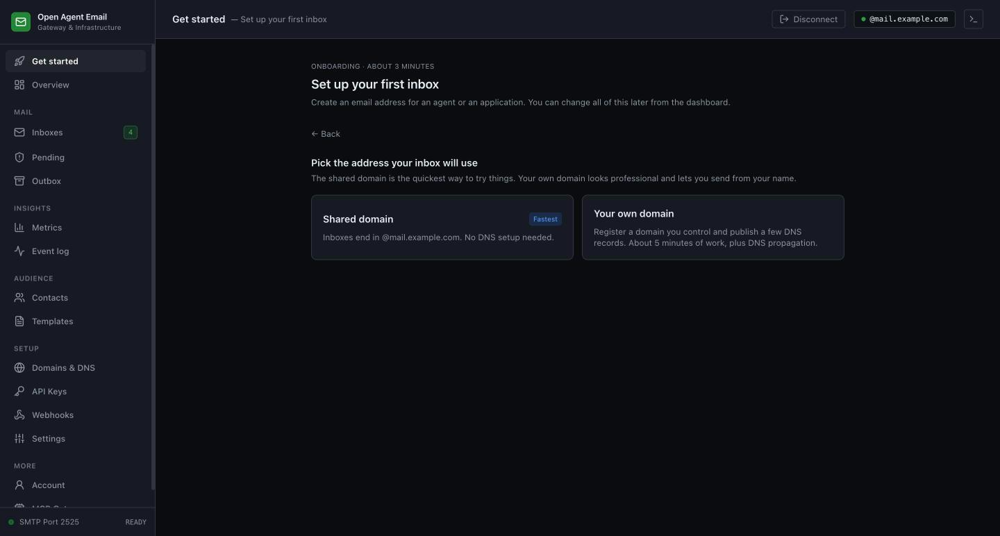
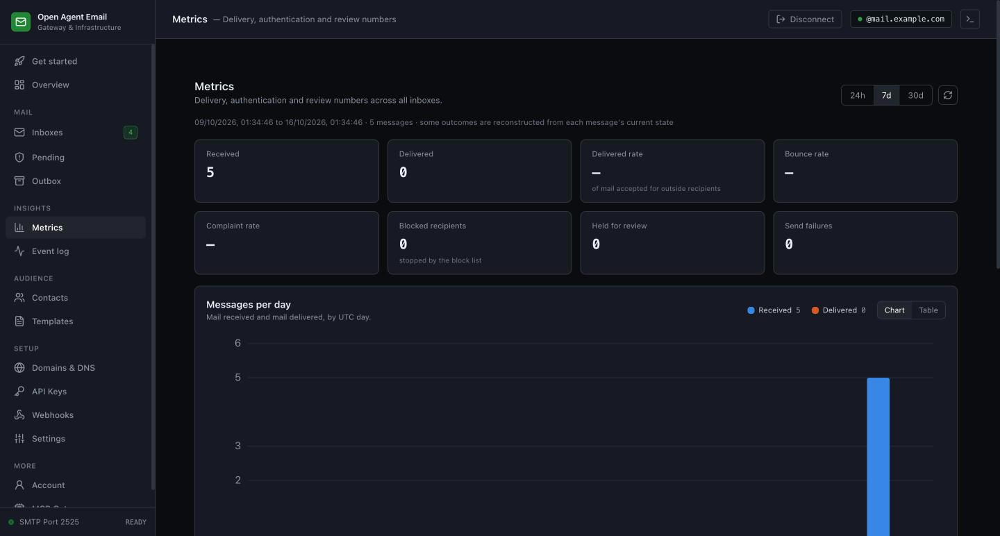
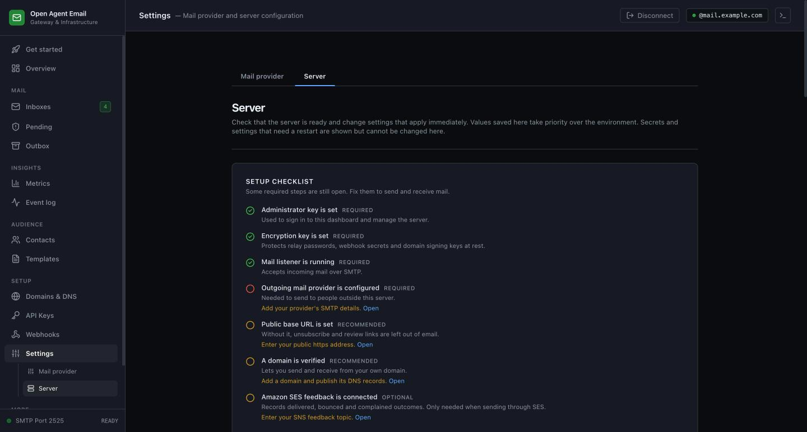

<div align="center">

# Open Agent Email

### Email inboxes for AI agents. Open source, self-hosted.

Give every agent a real email address. It can receive mail, reply in the same thread, send new messages, and wait for a person to approve anything risky. Use it through a REST API, Python and TypeScript SDKs, a command line, webhooks, a live stream, or MCP for coding agents like Claude Code and Cursor.

[](LICENSE)


[Quickstart](docs/quickstart.md) · [How it works](#how-it-works) · [Dashboard](#the-dashboard) · [Go live](#going-live-on-a-server) · [Docs](#documentation) · [FAQ](#faq)



</div>

## Related Projects

- [awesome-open-source-saas-alternatives](https://github.com/Anil-matcha/awesome-open-source-saas-alternatives) — curated open-source alternatives to paid SaaS apps.
- [open-agent-connector](https://github.com/Anil-matcha/open-agent-connector) — self-hosted MCP and REST gateway that connects agents to hundreds of app APIs; pairs with this project for agents that need both email and app access.
- [awesome-generative-ai-apps](https://github.com/Anil-matcha/awesome-generative-ai-apps) — open-source generative AI apps you can clone and deploy.
- [awesome-vibecoded-saas](https://github.com/Anil-matcha/awesome-vibecoded-saas) — open-source alternatives to SaaS tools people pay for.

## Why Open Agent Email

Agents that work with people end up needing email: to answer customers, confirm sign-ups, chase invoices, or hand a decision to a human. A shared Gmail login or a bare sending API gives an agent no identity of its own, no conversation history, no safety net, and nothing to stop one mistake from reaching a customer. Open Agent Email gives each agent its own address and mailbox, with the controls you would want around software that can write to real people.

- **One inbox per agent.** Real addresses, real threads, replies that land in the right place.
- **A person stays in control.** Hold risky mail for approval, with approve and reject links, an expiry, and a full history of what happened.
- **You own everything.** Self-hosted, Apache-2.0, SQLite or PostgreSQL, your own domain, your own sending provider.

## How it works

```
   People (Gmail, Outlook…)  ·  other agents
          │   ▲
  incoming │   │ outgoing
     SMTP  ▼   │ your sending provider (SES, Resend, SendGrid, Postmark, Gmail…)
   ┌────────────────────────────┐
   │     Open Agent Email       │  ← your MX record points here
   │                            │
   │  in:  scan · check SPF,    │
   │       DKIM, DMARC · file   │
   │       into the inbox       │
   │  out: optional approval    │
   │       hold · send          │
   └────────────────────────────┘
          │   ▲
  new mail │   │ send · reply · forward
          ▼   │
   ┌────────────────────────────┐
   │        your agent          │  ← REST · webhooks · live stream · MCP · SDKs · CLI
   └────────────────────────────┘
```

**Coming in.** Someone sends to `hello@mail.example.com`. Your MX record points that domain at your server, which listens for mail on port 25. It reads the address, finds the inbox called `hello`, checks the sender (SPF, DKIM and DMARC), scans for tricks aimed at AI, and stores the message. An address with no inbox is refused, and the server never relays mail for other people.

**Going out.** Every inbox sends through one relay you configure once, for example Amazon SES. Each message leaves from its own inbox address, so replies come back to that inbox. If you turn on the approval gate, the message waits until a person approves it.

## Get started

You need Python 3.11 or newer.

```bash
git clone https://github.com/Anil-matcha/open-agent-email.git
cd open-agent-email
./scripts/dev.sh
```

That starts the server at `http://127.0.0.1:8000`, creates the secrets it needs, and prints your admin key. Then follow the **[quickstart](docs/quickstart.md)** to create an inbox, receive and send your first email, and connect an agent. It takes about five minutes.

To run the dashboard as well:

```bash
cd client && npm install && npm run dev   # http://localhost:3000, sign in with the admin key
```

Prefer Docker?

```bash
docker compose up -d --build
docker compose logs server | grep "Admin key"   # printed once on first start
```

Secrets are generated on first start and kept in a Docker volume (see the [quickstart](docs/quickstart.md) for backing it up). The dashboard is on port 3000, the API on 8000, and the mail listener on 2525 (map it to 25 to receive mail from the internet).

## Four ways to plug in your agent

**1. MCP, for coding agents.** Give Claude Code, Cursor or any MCP client an email toolset: list, read, search, send, reply, forward, approve, and more (96 tools).

```bash
claude mcp add --transport http open-agent-email http://127.0.0.1:8000/mcp/rpc \
  --header "Authorization: Bearer $OAE_API_KEY"
```

**2. SDKs, for your own code.** Python (no dependencies) and TypeScript (no dependencies), with typed errors, paging helpers, and webhook signature checks.

```python
from open_agent_email import AgentEmailClient

client = AgentEmailClient("http://127.0.0.1:8000", api_key="oae_...")
for message in client.list_messages("hello@mail.example.com", direction="inbound"):
    print(message["sender"], message["subject"])
```

```ts
import { AgentEmailClient } from "@open-agent-email/sdk";

const client = new AgentEmailClient({ baseUrl: "http://127.0.0.1:8000", apiKey: process.env.OAE_API_KEY! });
await client.messages.send("hello@mail.example.com", { recipient: "you@example.com", subject: "Hi", body_text: "Hello" });
```

**3. REST, webhooks and a live stream, for any language.** Poll the API, subscribe a signed webhook, or open a WebSocket that works from a laptop behind a firewall with no public URL.

```bash
curl -s http://127.0.0.1:8000/v1/agents/hello@mail.example.com/messages \
  -H "Authorization: Bearer $OAE_API_KEY"
```

**4. The command line.** `oae` lists and sends mail from a terminal, and `oae listen` pipes new mail to a local handler.

```bash
oae messages list --agent hello@mail.example.com
oae messages send --agent hello@mail.example.com --to you@example.com --subject Hi --body "Hello"
```

## What you can build

- **A support inbox for an AI assistant.** Give an agent `support@yourbrand.com`, let it triage and answer in-thread, and hold sensitive replies for a person to approve.
- **Sign-up and verification flows.** An agent creates accounts and reads the confirmation code from its own inbox with one call.
- **Outreach with a safety net.** Draft and schedule messages, keep contact lists and follow-up reminders, block recipients who bounce or complain, and never send to someone who asked to stop.
- **Email between agents.** Each agent has a real address, so agents inside and outside your company can exchange mail like people do.
- **Email-triggered workflows.** Turn incoming mail into events for n8n, Zapier or your own services, and send templated replies.
- **A personal concierge.** A local agent watches an inbox over the live stream, drafts replies, and waits for your approval.

## Features

| | |
|---|---|
| **Inboxes and threads** | Many inboxes per server, proper reply threading, conversation view, labels, read and unread, search, trash and restore, scheduled send up to 90 days ahead, attachments up to 10 MB each, signed download links. |
| **Safety** | Flags prompt-injection tricks and hidden text, optional virus scanning, approval gate with emailed approve and reject links and an expiry, per-inbox keys with read-only, send and review-only scopes, recipient blocking, one-click unsubscribe links. |
| **Authentication** | SPF, DKIM and DMARC checked on every incoming message, with the result kept on the message. A message from a domain that publishes a strict DMARC policy and fails it is refused. |
| **Sending** | Any SMTP relay. Retries with backoff, a queue you can inspect and retry, safe retries with idempotency keys, and a full history for every message. |
| **Delivery tracking** | With Amazon SES, delivered, delayed, bounced and complained events come back automatically, and bad addresses are blocked for you. |
| **Domains** | Add your own domain, get the exact DNS records, and verify them. Outgoing mail is DKIM-signed with a key per domain. |
| **Webhooks and events** | Signed webhooks with retries, replay, and delivery history. A searchable event log. Endpoints per inbox or for the whole account. |
| **Contacts and templates** | Address book, CSV import, consent notes, follow-up reminders, reusable templates with preview, starter templates. |
| **Developer tools** | REST API with an OpenAPI file, Python and TypeScript SDKs, the `oae` CLI, 96 MCP tools, structured errors with a fix hint, cursor paging everywhere. |
| **Operations** | SQLite or PostgreSQL, database migrations, a metrics endpoint, example alert rules, backup and restore scripts, secret rotation, rate limits, a Docker setup and a production deploy example. |

## The dashboard

Sign in with the admin key and do everything from the browser: set up, read mail, approve held messages, and watch what is happening.

<table>
<tr>
<td width="50%"><br><sub>Guided setup: pick the shared domain or your own.</sub></td>
<td width="50%"><br><sub>Metrics: delivery, bounces, complaints, per inbox.</sub></td>
</tr>
<tr>
<td colspan="2"><br><sub>Server settings with a checklist that shows what is still missing.</sub></td>
</tr>
</table>

| Area | What you can do |
|---|---|
| **Get started** | A short guided setup: pick the shared domain or your own, create an inbox and a key, and send yourself a test. |
| **Inboxes** | One page per inbox with tabs: Messages (read, reply, forward, label, schedule, trash and restore, message history), Follow-ups, Suppressions, Trash, and Settings (protection, approval hold, test message, delete). |
| **Pending** | Messages waiting for a person to approve or reject. |
| **Outbox** | Queued and sent mail, retries and failures. |
| **Metrics and Event log** | Delivery, bounce and complaint numbers, a per-inbox breakdown, and every event with a redeliver button. |
| **Contacts and Templates** | Address book, CSV import, consent notes, reusable and starter templates. |
| **Domains and DNS** | Add a domain, publish the records, verify them. |
| **API Keys and Webhooks** | Create and revoke keys, add webhook endpoints, see deliveries and replay them. |
| **Settings** | Mail provider (your sending relay) and Server (public URL, mail domain, SES feedback, retention and limits). |

Secrets such as the admin key and the encryption key are never shown or edited in the dashboard.

## Security

- **Keys with limited power.** Each inbox can have its own key: read-only, read and send, or review-only. Keys expire, and the admin key never leaves the server.
- **Secrets stored encrypted.** Relay passwords, webhook secrets and domain signing keys are encrypted at rest, with key rotation.
- **Safe webhooks.** Signed with a timestamp, HTTPS only, public addresses only, no redirects, with retries and a secret rotation overlap.
- **Careful receiving.** Unknown recipients are refused, nothing is relayed for strangers, sender checks run on every message, and size and connection limits protect the listener.
- **Prompt-injection screening.** Incoming mail is scanned for hidden text, role-switching tricks and data-leak links before an agent reads it, and suspicious mail can be held for review.
- **Approval gate.** Settings that weaken the gate can only be changed with the admin key, never by an agent's own key.

Report security problems privately to the maintainers rather than opening a public issue.

## Going live on a server

To receive mail from the internet you need a server with a public address, an MX record for your mail domain, and port 25 open. To send, you need a relay. [`deploy/`](deploy/) has a production example for one Linux host: a Docker Compose file, an nginx site, a deploy script and a backup script. Follow [`deploy/README.md`](deploy/README.md), then use the Settings checklist in the dashboard to finish.

For Amazon SES, verify your domain, add the DKIM records it gives you, create SMTP credentials, and enter them under Settings, then Mail provider. To get delivery and bounce events, send mail through an SES configuration set that publishes to an SNS topic, and subscribe `https://your-host/webhooks/ses` to it. The steps are in [Reference](docs/reference.md#1-upstream-smtp-relay-settings).

## FAQ

**Why not just use a sending service like Resend, SendGrid or Postmark?**
Those services send mail well, and some parse incoming mail, but they give an agent no mailbox of its own: no per-agent address with threads, no approval gate, no per-agent keys, no screening for prompt injection. Open Agent Email adds those, and you can still use any of those services as your outgoing relay.

**Why not run Postfix or Postal myself?**
A mail server moves mail. It doesn't know what an agent is. Open Agent Email sits on top and adds inboxes, an API, MCP, approvals, webhooks and a dashboard. It includes its own small listener for incoming mail, so you don't run a separate mail server.

**Do I need my own domain?**
Not to try it on your machine. To receive mail from the internet you need a domain with an MX record pointing at your server. Sending needs a relay such as Amazon SES, and your domain should be verified there so replies are trusted.

**Can several customers or teammates use one server?**
Not yet. It is single-user today: one admin key controls the server, and inboxes can have their own limited keys. Customer accounts and multi-tenant hosting are planned.

**Where is my data stored?**
In SQLite by default, or PostgreSQL for larger setups. Attachments are stored in the database too, up to 25 MB per message. Back up the database and the encryption key together.

**Is it safe to open port 25?**
The listener only accepts mail for inboxes that exist, refuses everything else, never relays for third parties, and limits message size and connections. Check it yourself after you deploy by trying to send to an outside address through your server's port 25: it should be refused.

**Which sending providers work?**
Any SMTP service: Amazon SES, Resend, SendGrid, Postmark, Gmail with an app password, or your own server. Delivery and bounce tracking is built for Amazon SES.

## Documentation

| | |
|---|---|
| [Quickstart](docs/quickstart.md) | First inbox, first email, SDKs and MCP |
| [Reference](docs/reference.md) | Settings, webhooks, review and approval flow, domains, the MCP tool list, scheduling, templates and more |
| [Deploying](deploy/README.md) | A production setup for one server |
| [Operations](docs/operations.md) | Running it in production: secrets, backups, upgrades, test results |
| [Monitoring](docs/monitoring.md) | The metrics endpoint and example alert rules |
| [SDK mapping](docs/sdk-mapping.md) | Short field names and nested SDK methods |
| [Dashboard coverage](docs/dashboard-coverage.md) | What the dashboard covers compared with the API |
| [Errors](docs/errors.md) | Every error code and how to fix it |
| API explorer | `/docs` on a running server |

## Tech stack

| | |
|---|---|
| Server | Python 3.11, FastAPI, SQLAlchemy (async), Alembic migrations, `aiosmtpd` for incoming mail |
| Database | SQLite by default, PostgreSQL supported |
| Dashboard | Next.js 16, React, Tailwind CSS |
| SDKs | Python and TypeScript, no runtime dependencies |
| Agents | MCP over HTTP, REST, webhooks, WebSocket |
| Packaging | Docker Compose, plus a production deploy example with nginx |

## Status

Open Agent Email is under active development and is currently **single-user**: one admin key controls the whole server, and there are no customer accounts or sign-up yet. It has been tested locally, on PostgreSQL 16, with two workers on one database, and live through Amazon SES, including delivered and bounced events. Receiving mail from large providers, off-host backups and per-customer limits are still being worked on, so read [Operations](docs/operations.md) before putting it in front of real traffic.

## Community

Questions, ideas and show-and-tell are welcome: join the [Discord](https://discord.com/invite/zpnuBRXhKg) or open an issue.

## Contributing

Issues and pull requests are welcome. Run the tests before you send a change:

```bash
cd server && pip install -r requirements-dev.txt && python -m pytest -q
cd sdks/typescript && npm ci && npm test
cd sdks/python && python -m pytest -q
```

If you change the API, regenerate the contract file with `python server/scripts/export_openapi.py` and commit it.

## License

Apache 2.0. See [LICENSE](LICENSE).
